# TrustFlow Commerce

**Evidence-backed milestone escrow for digital commerce on Solana Devnet.**

TrustFlow gives a buyer, seller, and named arbitrator a shared settlement record. A buyer funds a SOL milestone, the seller submits an evidence hash, and the buyer approves release to the recorded seller. Before approval, either party can dispute; the arbitrator can then refund the buyer.

**[Live app](https://trustflow-commerce-six.vercel.app)** · **[Judge guide](docs/JUDGE_GUIDE.md)** · **[Devnet evidence](docs/DEVNET_EVIDENCE.md)** · **[Security](docs/SECURITY.md)** · **[Architecture](docs/ARCHITECTURE.md)** · **[Testing](docs/TESTING.md)**

> **Scope:** Devnet SOL only. This is an experimental, unaudited hackathon project. The program is upgradeable and an upgrade authority was present when checked on 7 November 2026. An evidence hash does not prove delivery or quality. [Trust assumptions and limitations →](docs/SECURITY.md)

## Judge quick start

No wallet or transaction is needed to inspect the historical evidence:

1. Open the [live app](https://trustflow-commerce-six.vercel.app/#proof) and scroll through **Happy Path**, **Dispute Path**, and **Security checks**.
2. Inspect the finalized [release](https://explorer.solana.com/tx/2v5PD3eYrU8i2sEinL7CYSsu26w38mrYuWQXdHuJqHCYHG5g62NudxYD362G3R6u7LCmZKAk1T6ATJ8Nb9NPqzvA?cluster=devnet) and [refund](https://explorer.solana.com/tx/hDXjVABnJwfdN8RWJekQU3BPJZw8jteVP3MFsCfF62iNLToPnn9eRZFvLFQtSfAig7QZ1zAFVkaw3qMKn1MDpJn?cluster=devnet) transactions from separate escrows.
3. Review the [full evidence table](docs/DEVNET_EVIDENCE.md), including intentionally rejected transactions, or follow the [two-minute judge route](docs/JUDGE_GUIDE.md).

The historical lifecycle was generated by a script, not verified as a complete browser/Phantom walkthrough. An optional live test requires three distinct funded Devnet wallet accounts and explicit wallet approvals.

## What it does

- **One milestone per escrow:** record buyer, seller, arbitrator, amount, and a unique ID in a program-derived account.
- **Evidence hash:** the seller submits a nonzero 32-byte value; the browser hashes the selected file with SHA-256 and keeps the file local.
- **Buyer-approved release:** after evidence submission, the buyer approves. Anyone can trigger release, but the program pays only the recorded seller.
- **Dispute and refund:** before approval, buyer or seller may dispute. Only the recorded arbitrator can refund the recorded buyer.
- **Transparent history:** the UI links to historical finalized Devnet transactions and clearly labels expected rejections.

## Lifecycle

```mermaid
stateDiagram-v2
    [*] --> Created
    Created --> Funded: buyer funds
    Funded --> EvidenceSubmitted: seller submits hash
    EvidenceSubmitted --> Approved: buyer approves
    Approved --> Released: anyone triggers; seller receives SOL
    Funded --> Disputed: buyer or seller
    EvidenceSubmitted --> Disputed: buyer or seller
    Disputed --> Refunded: arbitrator refunds buyer
```



Release and refund are terminal. There is **no timeout refund**, no cancellation of a created account, and no seller-payout resolution after a dispute. An unavailable arbitrator can leave a dispute unresolved. Account rent and unsolicited extra lamports remain in the escrow account after settlement.

## Architecture and stack

The [Anchor program](programs/trustflow_escrow/src/lib.rs) holds lamports in an escrow PDA and enforces role, state, and recipient constraints. The [Next.js frontend](app/page.tsx) reads Devnet accounts, builds instructions, and asks Phantom to sign. SHA-256 runs in the browser; the program stores only the supplied 32-byte hash. The static frontend is hosted on Vercel and uses the public Solana Devnet RPC.

| Layer | Implementation |
| --- | --- |
| Program | Rust, Anchor; workspace lockfile resolves `anchor-lang` 0.31.3 |
| Client | Next.js, React, TypeScript, `@solana/web3.js`, Phantom provider |
| Network | Solana Devnet; native Devnet SOL |
| Hosting | Vercel static export; no application server or server-side wallet |

See [architecture](docs/ARCHITECTURE.md) for account derivation and transaction details.

## Run locally

Prerequisites: Node.js 22 and npm. Client checks additionally require the generated Anchor IDL described in [Testing](docs/TESTING.md).

```bash
npm ci
npm run dev              # http://localhost:3000
```

The frontend defaults to the deployed Devnet program. An optional `NEXT_PUBLIC_ESCROW_PROGRAM_ID` is a **public** build-time override. Never place private keys or seed phrases in the repository or browser environment variables.

```bash
npm run test:checks      # non-transaction RPC/IDL checks (local stubs)
npm run test:client      # client and wallet-session checks (local stubs)
./node_modules/.bin/tsc --noEmit --incremental false
npm run build
```

On 7 November 2026, 30 JavaScript checks, 7 Rust unit tests, TypeScript, and the production build passed locally. These checks are not a professional audit or a real-browser test. Validator and Devnet scripts create transactions and are documented separately in [Testing](docs/TESTING.md).

## Deployment and verified evidence

- **Program:** [8DK8Z1Uz8Nv3KTvVE7kxrm79mijQEL2nC5CAacPHgJ4Z](https://explorer.solana.com/address/8DK8Z1Uz8Nv3KTvVE7kxrm79mijQEL2nC5CAacPHgJ4Z?cluster=devnet)
- **Deployment:** [finalized Devnet transaction](https://explorer.solana.com/tx/4VtsgZ7cvJeReCQ1Fshs6KW1z7Qxgut3s2LLBnvgmaaWAB16wE4aotWC6yasBXKy44rvZkrkcjyhmi3edFpF9dXt?cluster=devnet)
- **Historical run:** 17 transaction signatures were rechecked as finalized with their expected outcomes on 7 November 2026; five are **expected failures**, not successful operations. [Evidence and provenance →](docs/DEVNET_EVIDENCE.md)
- **Frontend:** [public Vercel deployment](https://trustflow-commerce-six.vercel.app), built as a static export using [`vercel.json`](vercel.json).

## Screenshots and demo video

No suitable project screenshots are currently stored in this repository. Use the [capture checklist](docs/screenshots/README.md) to add genuine, redacted screenshots from the app and Explorer.

**Demo video:** not yet published. Record a short walkthrough after verifying the real Phantom flow; do not substitute historical script results for a browser demonstration.

## Repository map

| Path | Purpose |
| --- | --- |
| `programs/trustflow_escrow/` | Anchor program and transition rules |
| `app/`, `lib/` | Frontend, transaction client, and wallet-session handling |
| `tests/` | Local logic, client, wallet-session, and validator integration tests |
| `scripts/` | Devnet lifecycle and RPC helpers |
| `evidence/` | Original historical run and read-only RPC verification snapshot |
| `docs/` | Judge route, security model, architecture, testing, and evidence |
