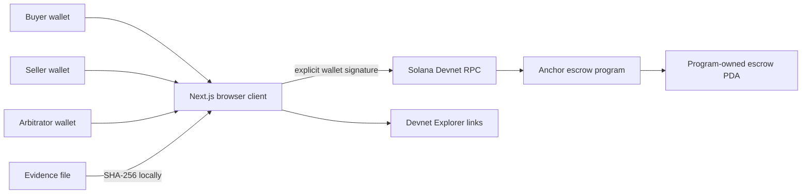

# Architecture

TrustFlow is a static browser client for a single-milestone SOL escrow program on Solana Devnet. The program owns and settles the escrow account; the frontend supplies instructions and displays the resulting public state. There is no backend wallet, VPS, evidence storage service, or AI component.



## Program and account

The program ID is [`8DK8Z1Uz8Nv3KTvVE7kxrm79mijQEL2nC5CAacPHgJ4Z`](https://explorer.solana.com/address/8DK8Z1Uz8Nv3KTvVE7kxrm79mijQEL2nC5CAacPHgJ4Z?cluster=devnet). `create_escrow` derives and initializes an `Escrow` PDA from:

```text
[ UTF-8 bytes of "escrow", buyer public-key bytes, id as little-endian u64 ]
```

The buyer pays account rent. The account stores the ID, buyer, seller, arbitrator, agreed lamports, 32-byte evidence value, status, and PDA bump. The buyer funds the same program-owned account using a System Program transfer; there is no separate SPL token vault. Release or refund moves exactly the agreed lamports out of the account. The account remains open, retaining its rent and any extra lamports.

Anchor account constraints and instruction handlers bind the buyer, seller, arbitrator, and recipients to the stored keys. [Program source](../programs/trustflow_escrow/src/lib.rs) · [Transition policy](../programs/trustflow_escrow/src/rules.rs)

## Settlement flow

1. **Create → Funded:** the buyer signs separate creation and funding transactions. The creation amount must be nonzero, and the three party keys must be distinct.
2. **Funded → EvidenceSubmitted:** the seller signs a 32-byte nonzero evidence value. The UI computes SHA-256 locally; the program does not enforce the hashing algorithm or store the file.
3. **EvidenceSubmitted → Approved → Released:** the buyer approves. Anyone can submit `release`; the seller account must match the stored recipient.
4. **Funded or EvidenceSubmitted → Disputed → Refunded:** the buyer or seller opens a dispute, and the named arbitrator signs the refund to the stored buyer. There is no timeout or seller payout from the disputed state.

`Released` and `Refunded` are terminal. The account creation, funding, evidence, approval, release, dispute, and refund instructions are separate transactions.

## Browser, wallet, and RPC

- [`app/page.tsx`](../app/page.tsx) renders the role-aware workflow, transaction status, historical evidence, and wallet menu. Public escrow addresses can be loaded without signing.
- [`lib/escrow.ts`](../lib/escrow.ts) derives PDAs, serializes instructions, decodes account state, checks the Devnet genesis hash, and submits signed transactions through `https://api.devnet.solana.com`.
- Phantom signs only after the user approves its prompt. The client checks returned message integrity and signature, obtains a fresh confirmed blockhash, checks its lifetime after signing, and uses confirmed preflight with the RPC context slot. It does not silently replace a signed transaction or automatically obtain a new signature. Unknown submission outcomes must be checked before retrying.
- The client sets an explicit 200,000-unit compute limit and zero compute-unit price. Its message validator rejects changed business instructions, accounts, permissions, fee payer, or blockhash; it permits only narrowly validated compute-unit-price additions for a message that does not already contain a price, subject to a cap. With the current client’s explicit price, a duplicate price is rejected.
- [`lib/wallet-session.ts`](../lib/wallet-session.ts) invalidates stale wallet work on disconnect or account change. A request already sent to an RPC before disconnection cannot be recalled.
- [`next.config.ts`](../next.config.ts) produces the `out/` static export. [`vercel.json`](../vercel.json) configures Vercel to serve it. No private environment value is required. Public RPC availability and rate limits remain external dependencies.

The IDL’s account auto-resolution metadata is disabled in [`Anchor.toml`](../Anchor.toml); the client derives the escrow PDA explicitly. [Security and trust assumptions →](SECURITY.md)
